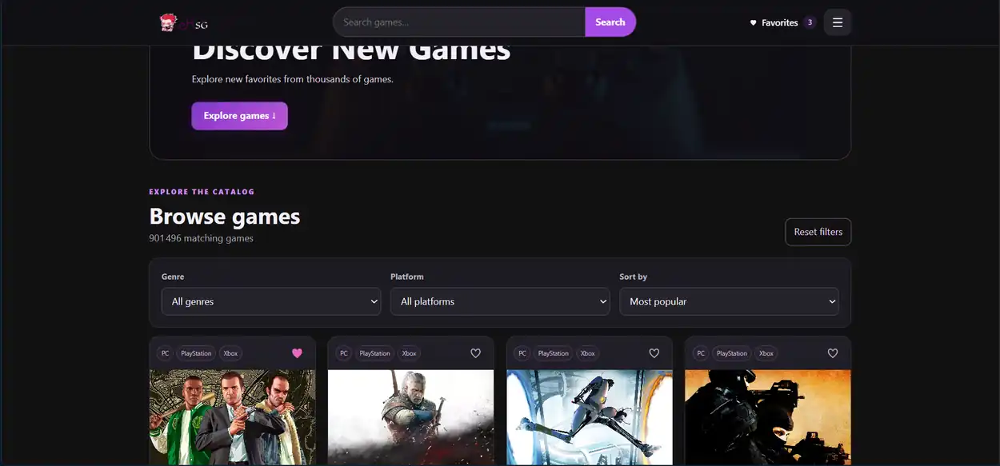

# 🎮 GameExplorer
Une application web qui permet de découvrir, rechercher et filtrer des jeux vidéo populaires via l’API RAWG.

## 📖 Description
GameExplorer est une application web interactive développée avec **HTML**, **CSS** et **JavaScript**.  
Elle permet aux utilisateurs de :
- Explorer une liste de jeux populaires.
- Rechercher un jeu par nom.
- Filtrer les jeux par genre, plateforme ou note.
- Consulter les détails d’un jeu.
- Sauvegarder leurs jeux favoris grâce au **localStorage**.

## 🚀 Fonctionnalités principales
1. 🧭 Explorer les jeux populaires depuis l’API RAWG.
2. 🔍 Rechercher un jeu par nom.
3. 🎚️ Filtrer les jeux par genre, plateforme ou note.
4. ❤️ Gérer ses favoris (ajout/suppression).
5. 📄 Voir la fiche détaillée d’un jeu.

## 🧑‍💻 Technologies utilisées
- HTML5  
- CSS3
- Tailwind
- JavaScript (ES6)  
- API RAWG  
- LocalStorage

# 🎮 GameExplorer

Une application web qui permet de **découvrir, rechercher et filtrer des jeux vidéo populaires** grâce à l’API RAWG.  
Développée avec **HTML, CSS et JavaScript**, cette application propose une expérience simple et fluide pour les passionnés de jeux vidéo.

---

## 🧩 Description

GameExplorer est une application web interactive qui permet aux utilisateurs de :

- 🧭 Explorer une liste de jeux populaires.
- 🔍 Rechercher un jeu par nom.
- 🎚️ Filtrer les jeux par genre, plateforme ou note.
- ❤️ Sauvegarder leurs jeux favoris et les consulter plus tard.
- 📄 Voir les détails complets d’un jeu (titre, description, genres, note, etc.).

---

## 🚀 Fonctionnalités principales (User Stories)

1️⃣ **Explorer les jeux**  
> En tant qu’utilisateur, je veux voir une liste de jeux populaires afin de découvrir de nouveaux titres.

2️⃣ **Rechercher un jeu**  
> En tant qu’utilisateur, je veux rechercher un jeu par nom pour le trouver rapidement.

3️⃣ **Filtrer les jeux**  
> En tant qu’utilisateur, je veux filtrer les jeux par genre, plateforme ou note pour affiner ma recherche.

4️⃣ **Gérer mes favoris**  
> En tant qu’utilisateur, je veux sauvegarder mes jeux favoris et les consulter plus tard.

5️⃣ **Voir les détails d’un jeu**  
> En tant qu’utilisateur, je veux consulter la fiche détaillée d’un jeu pour obtenir toutes les informations importantes.

---

## 🧑‍💻 Technologies utilisées

- **HTML5**
- **CSS3**
- **JavaScript (ES6)**
- **API RAWG** (https://rawg.io/apidocs)
- **LocalStorage**

---

## 🗂️ Structure du projet

📁 Jeux_Video_Catalogue
│
├── 📄 index.html
├── 📄 favoris.html
├── 📄 details.html
│
├── 📁 css
│ └── style.css
│
├── 📁 js
│ ├── main.js
│ ├── favoris.js
│ └── details.js
│
└── 📁 images
└── images

